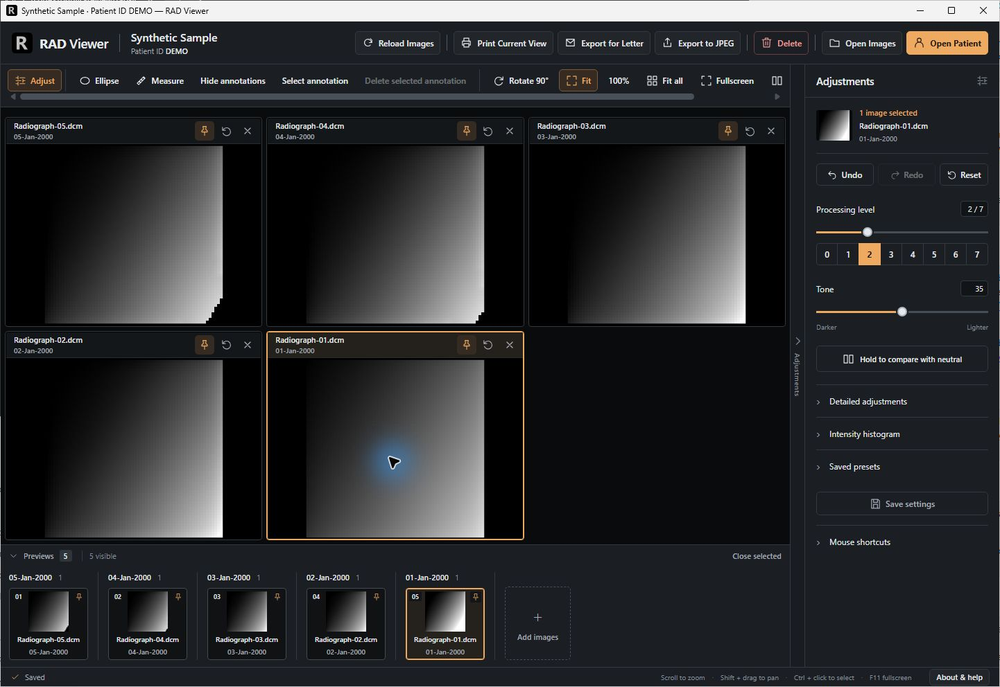

# RAD Viewer

A local desktop radiograph viewer built with Rust, Tauri 2, React and TypeScript. Created by Michal Goralski.



*RAD Viewer 0.9.11 displaying five generated test patterns after a processing shortcut.*

I built RAD Viewer because I wanted a more responsive viewer and more control over my daily workflow after frustrations with Carestream software. This is a personal engineering project; it is not affiliated with Carestream and makes no comparative performance claims.

This repository is a sanitized public-review snapshot of development version 0.9.11. It is not a published clinical release. Only mathematically generated test patterns are bundled; they are not radiographs or diagnostic examples.

## Features

- Open supported local DICOM, RVG, panoramic, PNG and JPEG files; arrange multiple panes and compare views.
- Adjust tone, gamma, contrast, sharpening, denoising and intensity-based color overlays. Press Ctrl+0 through Ctrl+7 to select a processing level. New images start at gamma 0.35 and contrast -40 unless saved adjustments exist.
- Zoom, pan, rotate, pin views, draw ellipses and retain adjustments in local sidecars.
- Export processed images and letter compositions; preview and submit Windows print jobs through installed drivers.
- Optional Windows patient-folder discovery and launch integration, with an explicitly configured root directory.

## Start developing

Use Node.js 22 LTS, npm, current stable Rust and the native prerequisites for Tauri 2. Windows requires Microsoft C++ Build Tools with the desktop C++ workload and WebView2. macOS requires Xcode command-line tools; Linux requires the appropriate WebKitGTK and native GUI libraries. Windows is the primary development target. Cross-platform code is present, but this snapshot does not establish native macOS/Linux acceptance.

```sh
npm ci
npm test
npm run build
cargo test --workspace --locked
npm run tauri dev
```

Synthetic demo fixtures are committed for reproducibility. Recreate them with `python scripts/generate_synthetic_demo.py` (Python 3, standard library only). Click **Open Synthetic Sample demo** in the app to inspect the mathematical patterns. No patient images are required for ordinary automated tests. Ignored performance tests referring to private samples are intentionally excluded from public verification; do not run `--ignored` expecting those samples.

For a local Windows bundle, install the platform prerequisites and run `npm run tauri build`. Build outputs are local artifacts, not an endorsed signed distribution. Do not copy deployment instructions from the private operational project.

## Try the workflow

1. Start the native app with `npm run tauri dev`, or run your locally built executable.
2. Click **Open Synthetic Sample demo** to load five generated patterns, or **Open Images** to choose authorized local test files.
3. Select a pane, adjust tone or processing, compare views, then Reset or export. Exports use your local Pictures folder; JPEG export also offers a folder picker. Treat any non-synthetic export as potentially sensitive.

## Architecture

`src/` contains the React UI, image selection and workspace state, dialogs and export composition. `crates/rad-core/` decodes image data and implements processing recipes, presets and review calculations. `src-tauri/` connects the native shell to file discovery, sidecars, image exports, printing and the synthetic demo. The application uses Tauri commands rather than a hosted application backend.

## Limitations

This project has not established diagnostic-device certification, clinical validation, complete vendor-format coverage or physical printer acceptance. Decoder support is intentionally constrained; unsupported encodings and malformed files may fail. Color overlays describe image intensity, not calibrated tissue properties. Exports may lose source precision or metadata. Validate any workflow independently using authorized test data before considering clinical use.

Windows patient-number lookup is disabled until `RAD_VIEWER_PATIENT_ROOT` is set before launch. It expects the current or legacy ABELDent folder layout under that root. Ordinary file opening needs no integration configuration. Exports default to the local Pictures folder; no practice network destinations are configured. Direct printing is Windows-specific. The retained macOS configuration is source support, not a verified native release.

## Public snapshot and licensing

See [PROVENANCE.md](PROVENANCE.md) for exclusions and sanitization, [VERIFICATION.md](VERIFICATION.md) for actual checks, and [SECURITY.md](SECURITY.md) for data handling. Source is offered under the [MIT License](LICENSE). Third-party dependencies retain their own licenses.
